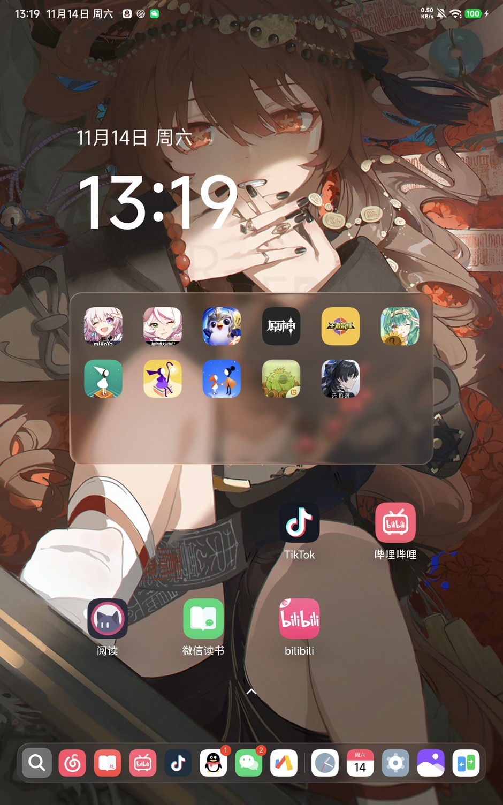
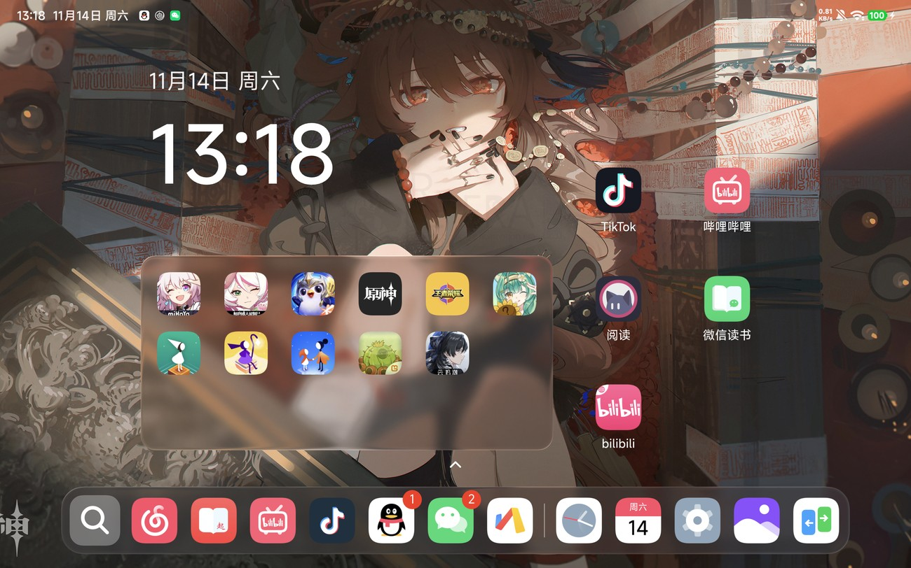
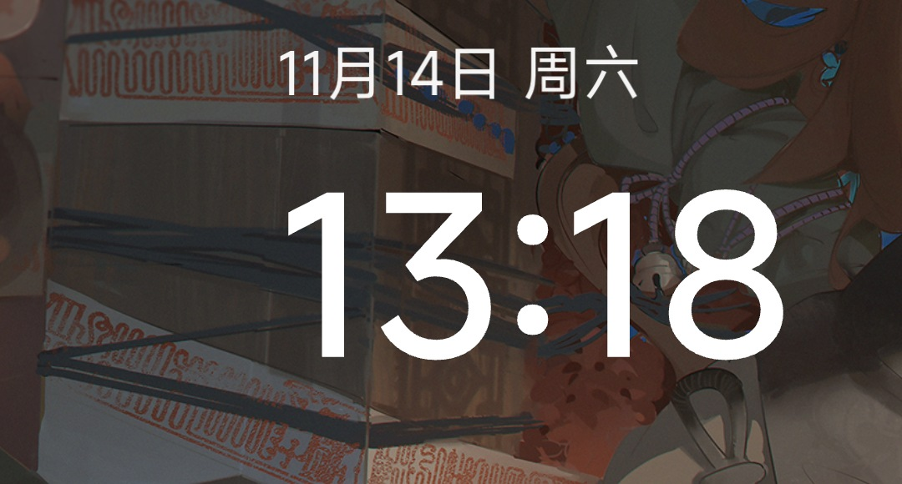

# HyperOS 时钟小部件

一个只显示「**时:分** + **日期**」的 Android 桌面小部件。配色自动跟随壁纸明暗，
点日期进日历、点时间进时钟。

**核心特点：运行期间 App 进程根本不存在** —— 没有前台服务、没有常驻通知、没有闹钟、**零权限**。

## 实机截图

竖屏（Redmi K Pad，HyperOS 4，组件 4×2）：



横屏：



局部放大（横屏，组件本体原分辨率裁切）：



| 需求 | 实现 |
|---|---|
| 只要时分，不要秒 | `TextClock` + `HH:mm` |
| 上面加日期 | 独立 `TextClock` 行，`M月d日 E`（中文）/ `EEE, MMM d`（英文） |
| 4×2 格子 | `targetCellWidth=4` `targetCellHeight=2`，基准 280×120dp |
| 可调节大小 | `resizeMode="horizontal\|vertical"`，字号随尺寸自动缩放（0.5×~2.0×） |
| 跟随壁纸变色 | 读系统算好的壁纸主色，按 WCAG 相对亮度决定白字/深色字 |
| 系统字体 | 时间 `sans-serif-medium`，日期 `sans-serif`，不打包任何字体 |
| 不占后台 | 无服务、无通知、无 wakelock、**连闹钟都不排** |
| 点击跳转 | 日期→日历，时间→时钟 |
| root | **不需要** |

## 兼容性

- `minSdk 30` / `targetSdk 36`
- 实测设备：**Redmi K Pad（25079RPDCC）**，Android 17（SDK 37），HyperOS V816（澎湃OS 4）
- 依赖的都是 Android 12+ 的公开 API，其它 ROM 未逐一实机验证

## 安装

1. 从 [Releases](../../releases) 下载 APK，`adb install` 或直接点开安装
2. 长按桌面空白处 → 小部件 → 找到「桌面时钟」→ 拖到桌面，拉成 4×2
3. **App 没有启动图标**，这是刻意的：它只提供小部件，不占应用列表

## 用法

| 点击位置 | 行为 |
|---|---|
| 日期行（整行可点） | 打开日历，优先"今天"视图，解析不到退回日历 App |
| 时间行（整行可点） | 打开时钟 App |
| 空白处 | 立刻重新取色（换完壁纸想马上生效就点一下） |

## 字重

| 元素 | 字体 | 说明 |
|---|---|---|
| **时间** | `sans-serif-medium` | 当前使用，中等字重 |
| **日期** | `sans-serif` | 常规字重，未加粗 |
| 时间（初版） | `sans-serif-light` | 细体；实机看偏纤细，已改为 medium |

同一张壁纸下的两版对比（上：`sans-serif-light` 细体 / 下：`sans-serif-medium` 中等字重）：


笔画粗细的客观测量（截图中暗像素连续段的中位宽度）：**细体 16px → 中等字重 26px**。

字体全部是系统自带，不打包任何字体文件。想更粗可以再上 `sans-serif` + `textStyle="bold"`
或 `sans-serif-black`，但注意：**`fontFamily` 属布局级属性，改了必须让桌面重新 inflate 才生效**
（见下方"踩过的坑"第 1 条）。

## 实现要点

### 1. 为什么 App 不需要常驻

关键在 `TextClock`：

- 类上标了 `@RemoteView`，可以放进 `RemoteViews` 布局；
- `setFormat24Hour` / `setFormat12Hour` 标了 `@RemotableViewMethod`，
  可以被 `RemoteViews.setCharSequence(id, "setFormat24Hour", "HH:mm")` 按方法名反射调用；
- **走字逻辑跑在桌面（launcher）进程里**，每分钟自刷新一次，跨天日期也会自己更新。

实测验证：`am force-stop` 杀掉本 App 后，进程数=0，组件仍从 `12:15` 走到 `12:17`。

日期行同样用 `TextClock`：它走 `android.text.format.DateFormat`，支持 `M`/`d`/`E` 等字符，
所以纯日期格式可以直接用，不需要 App 推送。

### 2. 配色

按可用性依次尝试：

1. `WallpaperManager.getDrawable()` —— 最准，但 **Android 14 起必定抛 `SecurityException`**
   （需要 `MANAGE_EXTERNAL_STORAGE`），所以在新系统上必然失败，实际不生效；
2. `WallpaperManager.getWallpaperColors(FLAG_SYSTEM)` —— 系统自己算好的壁纸主色，
   **无权限要求**，这是实际生效的主路径。带 `HINT_SUPPORTS_DARK_TEXT` 提示时直接采信；
3. 兜底按系统深浅色模式推断。

判定：`HINT_SUPPORTS_DARK_TEXT` 置位 → 深色字；否则按 WCAG 相对亮度，`< 0.5` → 白字。

### 3. 刷新时机（三层，全部零权限）

刻意**不用任何闹钟**：`setAlarmClock` 会在状态栏挂一个闹钟图标（对时钟组件是硬伤），
`setExact` 需要 `SCHEDULE_EXACT_ALARM` 权限，`setInexactRepeating` 又会在系统里多一条常驻闹钟。

| 触发 | 时效 | 代价 |
|---|---|---|
| `updatePeriodMillis = 1800000`（系统 AppWidgetService 驱动） | ≤30 分钟 | 0，App 不在也能触发 |
| 清单静态注册的 `WallpaperChangedReceiver` | 若 ROM 带 `FLAG_RECEIVER_INCLUDE_BACKGROUND` 投递则即时 | 0 |
| **点击组件空白处** | 立即 | 0 |

### 4. 点击跳转

先按候选包名找各 ROM 的启动入口（`com.android.deskclock` / `com.miui.clock` / `com.android.calendar` …），
再退回标准 action（`SHOW_ALARMS`、`content://com.android.calendar/time/<now>`、`CATEGORY_APP_CALENDAR`）。
**解析不到就不设点击**——宁可点了没反应，也不弹一屏"用什么打开"的选择器。

需要在 `AndroidManifest.xml` 里声明 `<queries>`，否则 Android 11+ 的包可见性会让
`getLaunchIntentForPackage()` 一律返回 null。

## 踩过的坑（都已解决，写在这里省你时间）

1. **MIUI 桌面更新组件时不重新 inflate**
   日志：`performApplyActions ... vgAdd(cloneHit=0 inflate=0)`。它只在已有视图树上打补丁，
   **旧的点击监听不会被清掉**，布局级属性（`fontFamily` 等）也不会重新读取。
   表现：反复覆盖安装后"点的位置和打开的应用对不上"，或改了字体没变化。
   解决：改布局文件资源 ID（改名），或删掉组件重新添加。

2. **`ACTION_WALLPAPER_CHANGED` 不在 Android 8 起的隐式广播豁免名单里**
   后台时 manifest 接收器通常收不到，所以它只是"尽力而为"，正确性由 30 分钟周期刷新兜底。

3. **`WallpaperManager.getDrawable()` 在 Android 14+ 必抛 `SecurityException`**，别再指望它。

4. **`WallpaperColors.getSecondaryColor()` / `getTertiaryColor()` 可能为 null**
   （实测本机就是 null），取值前必须判空，否则整条取色路径被一个 NPE 打断。

5. **`Chronometer` 的 base 是 `elapsedRealtime` 不是墙钟**，拿来当时钟用会显示错，所以弃用。

## 构建

**没有用 Gradle**，直接调 SDK 工具链。原因是这个项目只有一个模块、零依赖，
Gradle 拉下来的构建时间比编译本身长得多。

```bash
cd /path/to/repo
# 先按需修改 build.sh 顶部的工具链路径
bash build.sh
```

产物：`dist/ClockWidget-1.0.apk`

### 工具链（实测版本）

| 环节 | 工具 | 版本 |
|---|---|---|
| 编译资源 | `aapt2` compile / link | Android SDK Build-Tools **36.0.0** |
| 生成 `R.java` | `aapt2 link --java` | 同上 |
| 编译 Java | `javac --release 8` | **JDK 17.0.21+9** |
| 转 dex | `d8`（`com.android.tools.r8.D8`） | Build-Tools 36.0.0 自带 |
| 注入 dex | `tools/inject.py` | Python 3.13（标准库 `zipfile`） |
| 对齐 | `zipalign -f -p 4` | Build-Tools 36.0.0 |
| 签名 | `apksigner`（debug keystore） | Build-Tools 36.0.0 |
| 编译 SDK | `android.jar` | Android SDK Platform **android-36** |

`tools/inject.py` 是必需的一环：`aapt2 link` 产出的 APK 里没有 `classes.dex`，
用 Python 的 `zipfile` 把 d8 的产物塞进去，同时保留原有条目的压缩方式与时间戳。

## 开发方式与工具（透明说明）

- **源码手写**，无第三方依赖、无 Gradle、无 AndroidX。
- **AI 辅助**：代码由 WorkBuddy（模型 DeepSeek-V4.1-Flash）生成。
  几个决定性 API 语义不是猜的，而是逐条查 AOSP 源码确认的：
  `TextClock` 的 `@RemoteView` / `@RemotableViewMethod`、
  `RemoteViews.setCharSequence` 的反射调用链、`android.text.format.DateFormat.format` 支持哪些字符、
  `WallpaperColors` 三个 HINT 常量的真实数值、`Chronometer` 的 base 类型。
- **真机验证**：用 `adb` 全程实测，不是"应该能跑"。

常用的验证命令：

```bash
# 组件是否被系统接管、占多大、刷新周期
adb shell dumpsys appwidget | grep -A6 'com.zuakeo.clockwidget'

# 杀进程后组件是否还能自己走字（验证不常驻）
adb shell am force-stop com.zuakeo.clockwidget
adb shell ps -A | grep clockwidget      # 应为空
adb exec-out screencap -p > before.png  # 等 1 分钟后对比时间

# 取色走了哪条路径
adb logcat -d | grep ClockTone

# 点击到底跳没跳
adb shell dumpsys activity activities | grep topResumedActivity

# 桌面实际加载的网格
adb logcat -d | grep -o "loadGridConfig oldX:[0-9]* oldY:[0-9]*"
```

## 目录结构

```
.
├── build.sh                  # 无 Gradle 构建脚本
├── src
│   ├── AndroidManifest.xml
│   ├── java/com/zuakeo/clockwidget
│   │   ├── ClockWidgetProvider.java     # 小部件主体：渲染 / 点击 / 字号缩放
│   │   ├── WallpaperTone.java           # 壁纸取色与明暗判定
│   │   ├── WallpaperChangedReceiver.java# 换壁纸广播（尽力而为）
│   │   ├── WallpaperWatch.java          # 进程存活期的即时监听
│   │   └── SystemEventReceiver.java     # 改时间/时区/语言
│   └── res
│       ├── layout/                      # 深色字版 / 浅色字版
│       ├── xml/clock_widget_info.xml    # 4×2、可缩放、30 分钟刷新
│       └── values*/strings.xml          # 中英文日期格式
├── tools/inject.py           # 把 dex 注入 aapt2 产出的 APK
└── docs/                     # 预览图
```

## 致谢

- **晨钟酱（[CzJam](https://github.com/CzJam)）**
  需求方给的 `Sony_Light.apk` / `Sony_Dark.apk` 是**索尼官方时钟小部件的晨钟酱修改版**
  （包名 `com.sonymobile.advancedwidget.Lightclock.cz`，应用名标注 "Modified by CZ"）。
  本项目**参考了它的视觉样式与组件尺寸设定**（日期在上、大号时间在下、透明背景、4×2 布局），
  **没有使用它的任何代码或资源**，全部为本仓库自行编写。
- Sony 原版时钟小部件的设计。

## License

[MIT](LICENSE)
