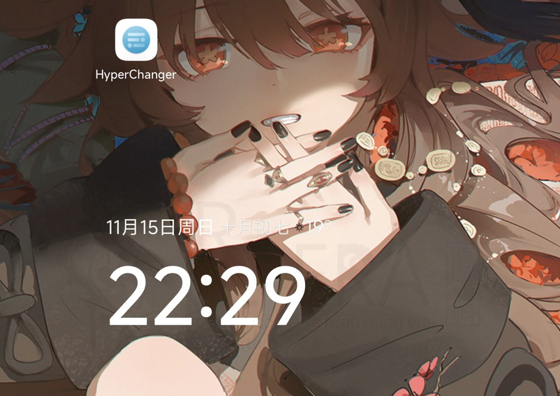
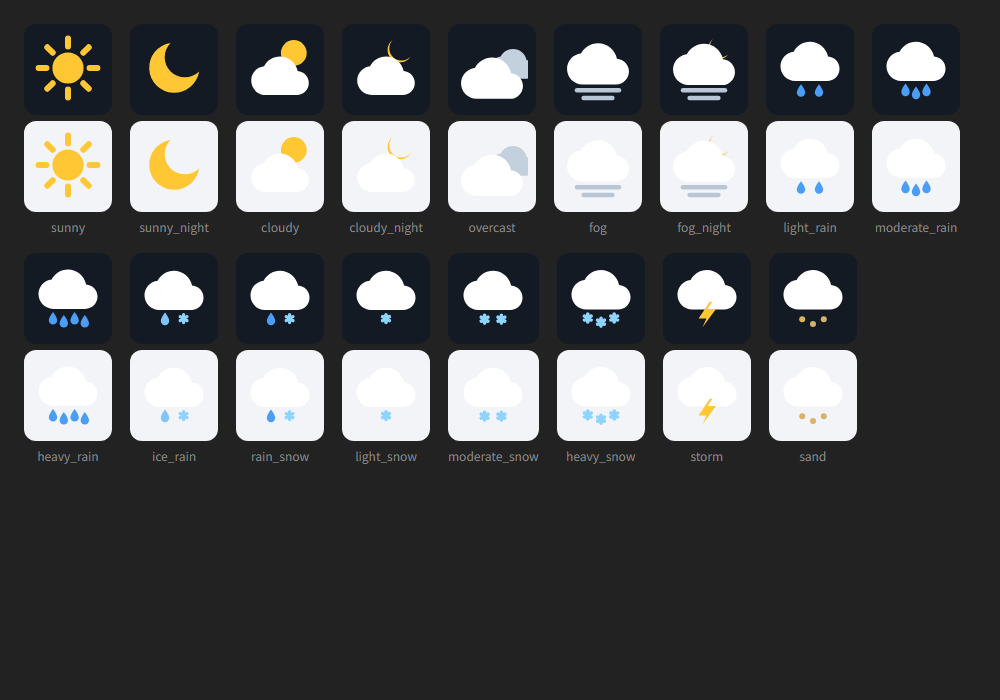
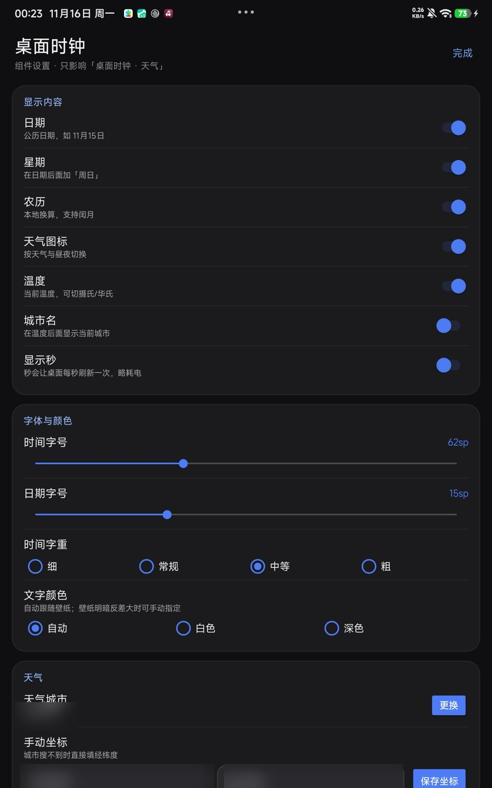
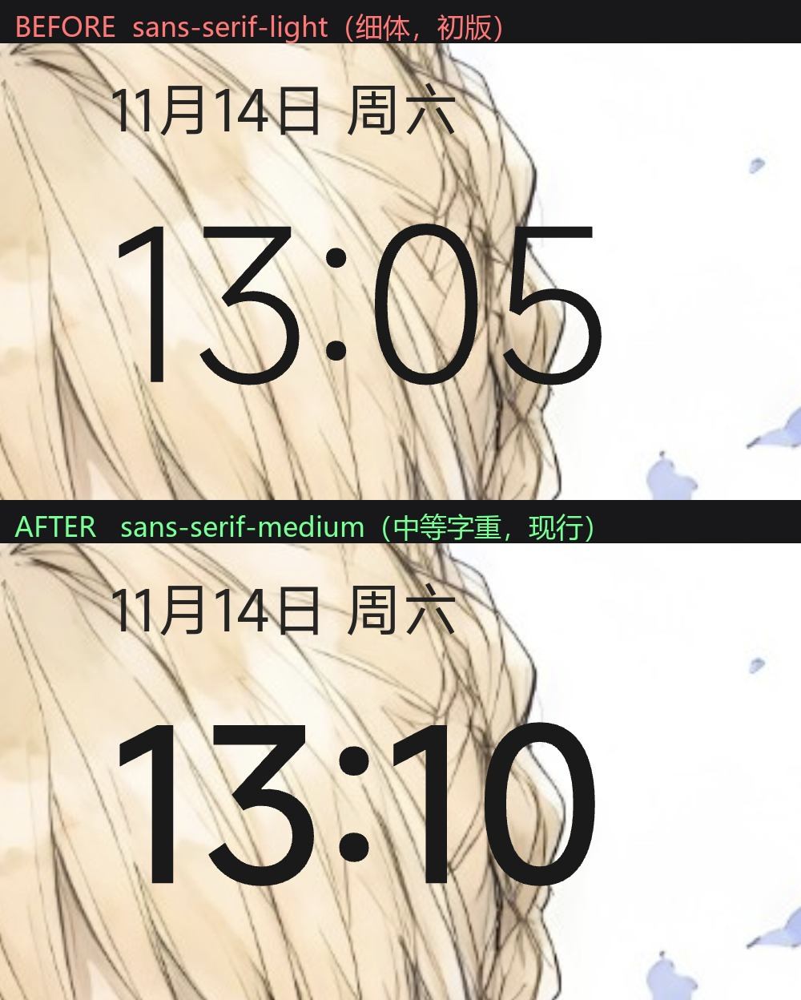

# HyperOS 时钟小部件

两个可以**同时摆在桌面上**的 Android 小部件：

| 组件 | 内容 | 需要联网 |
|---|---|---|
| **桌面时钟** | 日期 + 大号时分 | 否 |
| **桌面时钟 · 天气** | 日期 + 农历 + 天气 + 大号时分 | 是（Open-Meteo，免 API Key） |

两者是两个独立的 `AppWidgetProvider`，各有自己的布局、刷新周期与点击行为，
互不干扰；配色都跟随壁纸明暗，点日期进日历、点时间进时钟。

**桌面时钟（v1.0）的核心特点：运行期间 App 进程根本不存在** —— 没有前台服务、没有常驻通知、没有闹钟、**零权限**。

**桌面时钟 · 天气（v1.7）** 为了拉天气多了 `INTERNET`（普通权限，安装即授予，不弹窗、不可关闭），
其余仍然没有服务、没有通知、没有闹钟；天气每 30 分钟随组件刷新拉一次，断网时继续显示上一次的温度。
v1.2 起带一个桌面启动图标，进去可以关掉不想显示的元素、调字号与字重、切城市或手填经纬度。

> **不需要 root / KernelSU / LSPosed 保活。** 走字是桌面进程里的 `TextClock` 负责，
> 天气由系统 `AppWidgetService` 每 30 分钟拉起一次 `onUpdate`，拉完就退出。
> 加常驻服务只会多耗电，不会让组件更准。

## 实机截图

竖屏（Redmi K Pad，HyperOS 4，组件 4×2）：


横屏：


局部放大（横屏，组件本体原分辨率裁切）：


v1.5 天气组件（日期 + 农历 + 天气在上一行，大号时间在下一行，左对齐）：



17 种天气图标（每组上：深色壁纸 / 下：浅色壁纸）：



v1.2 设置页（带桌面启动图标）：



## 桌面时钟（v1.0）

| 需求 | 实现 |
|---|---|
| 只要时分，不要秒 | `TextClock` + `HH:mm` |
| 上面加日期 | 独立 `TextClock` 行，`M月d日 E`（中文）/ `EEE, MMM d`（英文） |
| 4×2 格子 | `targetCellWidth=4` `targetCellHeight=2`，基准 280×120dp |
| 可调节大小 | `resizeMode="horizontal\|vertical"`，字号随尺寸自动缩放（0.5×~2.0×） |
| 跟随壁纸变色 | 读系统算好的壁纸主色，按 WCAG 相对亮度决定白字/深色字 |
| 系统字体 | 时间 `sans-serif-medium`，日期 `sans-serif`，不打包任何字体 |
| 不占后台 | 无服务、无通知、无 wakelock、**连闹钟都不排** |
| 点击跳转 | 日期→日历，时间→时钟 |
| root | **不需要** |

## 桌面时钟 · 天气（v1.1 / v1.2）

| 需求 | 实现 |
|---|---|
| 日期 + 农历 | 日期用 `TextClock`（`M月d日E`，跨天自己走）；农历用本地 `LunarDate` 换算（1900–2100，含闰月） |
| 天气 | Open-Meteo `current=temperature_2m,weather_code,is_day`；WMO 代码 + 昼夜映射到 17 种扁平图标（白云 + 黄色太阳/月亮） |
| 手动选城市 | 点天气区域弹出「天气城市」，中英文搜索（Open-Meteo geocoding），选中即保存并刷新 |
| 4×2 格子 | `targetCellWidth=4` `targetCellHeight=2`，基准 280×120dp，可拖动缩放 |
| 跟随壁纸变色 | 自动（区域，root）/ 壁纸全局 / 手动白/深；天气图标是彩色的，深浅壁纸共用 |
| 点击 | 日期行→日历，时间行→时钟，天气区→选城市，空白处→立刻刷新天气 |
| 不占后台 | 无服务、无通知、无闹钟；天气在 `onUpdate` 的 `goAsync()` 里拉，拉完即走 |

农历算法用通用的 `lunarInfo` 压缩表，已用春节、闰月等 10 个已知日期校验
（2020 闰四月、2023 闰二月、2024/2025/2026/2027 春节等）。

## 设置页（v1.2+）

桌面新增「桌面时钟」图标，点开就是设置页（没有引 AndroidX，整页用系统控件手搭）。

| 分组 | 可调项 |
|---|---|
| 显示内容 | 日期、星期、农历、天气图标、温度、城市名、显示秒 —— 逐项开关 |
| 字体与颜色 | 时间字号 36–110sp、日期字号 10–26sp、时间字重 细/常规/中等/粗 |
| 取色 | 文字颜色 自动（区域）/ 壁纸全局 / 白色 / 深色；取样区域 顶部/整屏/底部 |
| 桌面与状态栏 | 隐藏桌面图标（快捷设置磁贴入口）；桌面有组件时隐藏状态栏时钟（内置 LSPosed 模块） |
| 天气 | 搜索城市、手动输入经纬度、摄氏/华氏、立即刷新 |
| 说明 | 数据来源、刷新机制、版本号 |

实现要点：

- **字重不能运行时改**：`fontFamily` 是布局级属性，`RemoteViews` 没有对应方法，
  所以按 4 档字重 × 2 种文字色**预生成 8 套布局**（`tools/gen_widget_layouts.py`），
  改字重时换布局资源 ID，桌面会重新 inflate。
- **字号**用 `RemoteViews.setTextViewTextSize` 下发，设的是基准值，组件拉大时仍按尺寸缩放。
- **显示项**用 `setViewVisibility`；日期行所有元素都关掉时整行隐藏，不留空白。
- 设置改动只广播 `RERENDER`（只重排、不联网）；换城市 / 手动坐标 / 刷新按钮才走
  `WEATHER_REFRESH` 联网。
- 手动坐标接受 -90~90 / -180~180，保存后城市名显示为「自定义位置」。
- 天气图标按 `weather_code` + `is_day` 切换：晴/多云分昼夜（太阳、月亮），
  雨/雪按强度分档，另有冻雨、雨夹雪、雷暴、浮尘，共 17 种；扁平风（白云 + 黄色太阳），
  云朵形状参考 Material Icons（Apache 2.0）。

## 状态栏时钟（内置 LSPosed 模块）

HyperOS 4 忽略 Android 的 `icon_blacklist clock` 和 `status_bar_show_clock`，root 改设置、重启 SystemUI 都无效——状态栏时间是 MIUI 自己的 `MiuiClock`。所以本应用**兼作 LSPosed 模块**：

- `assets/xposed_init` + `xposedmodule` 元数据，推荐作用域已声明为 `com.android.systemui`（LSPosed 里勾选模块时会自动带上「系统界面」）。
- 桌面**有没有**组件，靠一个空组件 `ClockFlag` 的启用状态告诉模块（见下）。
- 不需要给人 root；只需要在 LSPosed 里启用本应用（一次性），重启系统界面或设备。

### 状态栏左上角其实是两个控件（实测 Redmi K Pad / HyperOS 4）

| id | 类 | 内容 |
|---|---|---|
| `clock` | `com.android.systemui.baiyang.clock.StatusBarClock` | `00:21` ← 时间，要藏的就是它 |
| `pad_clock` | `com.android.systemui.statusbar.views.MiuiClock` | `11月17日 周二` ← 日期，必须留着 |

两者都在 `MiuiClockContainer ← phone_status_bar_left_container ← status_bar_contents` 里；锁屏时钟（`keyguard_clock`）、通知栏大时钟（`big_time`/`horizontal_time`）、下拉日期（`date_time`/`normal_control_center_date_view`）都是同族的 `MiuiClock`，**不能用类名一刀切**，只能按「父链里有状态栏容器 + id 是 `clock`」认。

### 四个踩过的坑（都实测过，改之前先看）

1. **hook 必须反射调**：ART 解析 `invoke-static` 时**返回类型也算签名**。Xposed 的 `findAndHookMethod` 官方返回 `XC_MethodHook.Unhook`，v1.6 手写的编译桩写成 `void`，于是每次调用都抛 `NoSuchMethodError`——异常被 catch 吞了，日志里只看到「hook 失败」，表现就是**一个 hook 都没挂上**。现在用反射按「名字 + 参数类型」找方法，不看返回类型，顺带兼容不同 LSPosed 版本。
2. **SystemUI 里查不到别人的组件**：`AppWidgetManager.getAppWidgetIds(别家 Provider)` 在 Android 17 直接 `SecurityException`（uid 1000 也没有 `BIND_APPWIDGET`）。改用 `PackageManager.getComponentEnabledSetting()` 读一个空组件的启用状态——跨包读不需要权限。app 侧在 `onEnabled/onDisabled/onUpdate/onReceive` 里同步这个标记。
3. **设一次 GONE 不够**：MIUI 每次刷新会把时钟改回 `VISIBLE`。现在在 `View#setVisibility(int)` 的 **before hook 里改 `param.args[0]`**（不改写方法，所以不会递归），只对时钟实例做 `instanceof` 过滤，开销可忽略。
4. **别用 `TextView#setText` 兜底**：那会把通知栏大时钟、下拉日期一起藏掉（踩过，日期就是这么没的）。

## 隐藏桌面图标

设置 → 桌面与状态栏 → 隐藏桌面图标：

- 桌面图标挂在 `activity-alias` 上，开关直接 disable/enable 这个组件；
- **先加磁贴再隐藏**：打开开关时会请求把「桌面时钟」磁贴加到快捷设置，之后从磁贴进设置；
- 也可以从 **LSPosed → 长按本模块 →「打开」** 进设置页（v1.7 起，见下节）；
- 三个入口都没有时，还能用 `adb shell am start -n com.zuakeo.clockwidget/.SettingsActivity` 打开。

## 从 LSPosed 打开模块设置（v1.7）

LSPosed 给模块列表的「打开」找入口的顺序是（`AppHelper.getSettingsIntent`）：

1. `ACTION_MAIN` + `de.robv.android.xposed.category.MODULE_SETTINGS` ← 模块设置页，优先
2. `ACTION_MAIN` + `CATEGORY_INFO`
3. `ACTION_MAIN` + `CATEGORY_LAUNCHER`

桌面图标挂在可 disable 的 alias 上，隐藏以后第 2、3 步全空，LSPosed 会直接把「打开」这一项删掉。所以 `SettingsActivity` 自己挂了一个 `MODULE_SETTINGS` 的 intent-filter，指向的就是时钟设置页——图标藏了也能从 LSPosed 进去。

## 兼容性

- `minSdk 30` / `targetSdk 36`
- 实测设备：**Redmi K Pad（25079RPDCC）**，Android 17（SDK 37），HyperOS V816（澎湃OS 4）
- 依赖的都是 Android 12+ 的公开 API，其它 ROM 未逐一实机验证

## 安装

1. 从 [Releases](../../releases) 下载 APK，`adb install` 或直接点开安装
2. 长按桌面空白处 → 小部件 → 找到「桌面时钟」或「桌面时钟 · 天气」→ 拖到桌面，拉成 4×2
   - 两个都能拖，互不影响；老组件不会被新版本替换
3. 天气组件第一次显示的是默认城市「北京」；点日期行右侧的温度区域，
   搜索并选择自己的城市（中英文都行，如 `Beijing` / `北京`），选完自动刷新
4. 更细的设置（显示项、字号、字重、摄氏/华氏、手动经纬度）打开桌面上的「**桌面时钟**」图标
5. App 的启动图标只用于设置页；不打开它时，组件照样工作

## 用法

| 点击位置 | 行为 |
|---|---|
| 日期行（整行可点） | 打开日历，优先"今天"视图，解析不到退回日历 App |
| 时间行（整行可点） | 打开时钟 App |
| 天气图标 / 温度（v1.6+） | 打开 MIUI 天气；没装天气 App 才回退「天气城市」 |
| 城市名（v1.1+） | 打开「天气城市」 |
| 空白处 | v1.0：立刻重新取色；v1.1+：立刻刷新天气 |
| 桌面图标「桌面时钟」 | 打开设置页（v1.2） |

## 字重

| 元素 | 字体 | 说明 |
|---|---|---|
| **时间** | `sans-serif-medium` | v1.0 / v1.1 默认；v1.2 可在设置页切 细/常规/中等/粗 |
| **日期** | `sans-serif` | 常规字重，未加粗 |
| 时间（初版） | `sans-serif-light` | 细体；实机看偏纤细，已改为 medium |

同一张壁纸下的两版对比（上：`sans-serif-light` 细体 / 下：`sans-serif-medium` 中等字重）：



笔画粗细的客观测量（截图中暗像素连续段的中位宽度）：**细体 16px → 中等字重 26px**。

字体全部是系统自带，不打包任何字体文件。想更粗可以再上 `sans-serif` + `textStyle="bold"`
或 `sans-serif-black`，但注意：**`fontFamily` 属布局级属性，改了必须让桌面重新 inflate 才生效**
（见下方"踩过的坑"第 1 条）。

## 实现要点

### 1. 为什么 App 不需要常驻

关键在 `TextClock`：

- 类上标了 `@RemoteView`，可以放进 `RemoteViews` 布局；
- `setFormat24Hour` / `setFormat12Hour` 标了 `@RemotableViewMethod`，
  可以被 `RemoteViews.setCharSequence(id, "setFormat24Hour", "HH:mm")` 按方法名反射调用；
- **走字逻辑跑在桌面（launcher）进程里**，每分钟自刷新一次，跨天日期也会自己更新。

实测验证：`am force-stop` 杀掉本 App 后，进程数=0，组件仍从 `12:15` 走到 `12:17`。

日期行同样用 `TextClock`：它走 `android.text.format.DateFormat`，支持 `M`/`d`/`E` 等字符，
所以纯日期格式可以直接用，不需要 App 推送。

### 2. 配色

按可用性依次尝试：

1. `WallpaperManager.getDrawable()` —— 最准，但 **Android 14 起必定抛 `SecurityException`**
   （需要 `MANAGE_EXTERNAL_STORAGE`），所以在新系统上必然失败，实际不生效；
2. `WallpaperManager.getWallpaperColors(FLAG_SYSTEM)` —— 系统自己算好的壁纸主色，
   **无权限要求**，这是实际生效的主路径。带 `HINT_SUPPORTS_DARK_TEXT` 提示时直接采信；
3. 兜底按系统深浅色模式推断。

判定：`HINT_SUPPORTS_DARK_TEXT` 置位 → 深色字；否则按 WCAG 相对亮度，`< 0.5` → 白字。

### 3. 刷新时机（三层，全部零权限）

刻意**不用任何闹钟**：`setAlarmClock` 会在状态栏挂一个闹钟图标（对时钟组件是硬伤），
`setExact` 需要 `SCHEDULE_EXACT_ALARM` 权限，`setInexactRepeating` 又会在系统里多一条常驻闹钟。

| 触发 | 时效 | 代价 |
|---|---|---|
| `updatePeriodMillis = 1800000`（系统 AppWidgetService 驱动） | ≤30 分钟 | 0，App 不在也能触发 |
| 清单静态注册的 `WallpaperChangedReceiver` | 若 ROM 带 `FLAG_RECEIVER_INCLUDE_BACKGROUND` 投递则即时 | 0 |
| **点击组件空白处** | 立即 | 0 |

### 4. 点击跳转

先按候选包名找各 ROM 的启动入口（`com.android.deskclock` / `com.miui.clock` / `com.android.calendar` …），
再退回标准 action（`SHOW_ALARMS`、`content://com.android.calendar/time/<now>`、`CATEGORY_APP_CALENDAR`）。
**解析不到就不设点击**——宁可点了没反应，也不弹一屏"用什么打开"的选择器。

需要在 `AndroidManifest.xml` 里声明 `<queries>`，否则 Android 11+ 的包可见性会让
`getLaunchIntentForPackage()` 一律返回 null。

### 5. 天气与农历（仅 v1.1）

- **农历**：`TextClock` 只认 `DateFormat` 的日期字符，做不了农历，所以用本地 `LunarDate`
  （1900–2100 压缩表）在每次组件刷新时重算。代价是跨过午夜后最多晚 30 分钟才换日，
  但日期行本身仍是 `TextClock`，跨天是准的。
- **天气**：`onReceive` 收到 `APPWIDGET_UPDATE` 后 `goAsync()` 起一个线程，
  6 秒超时拉 `api.open-meteo.com`，结果写进 `SharedPreferences` 再下发 `RemoteViews`。
  失败就继续用上一次的缓存，显示 `--°` 而不是空白。
- **手动选城市**：`CityPickerActivity` 是个没有启动图标的对话框 Activity，
  搜索走 `geocoding-api.open-meteo.com`（中英文都行），选中后保存经纬度并广播刷新。
- **不需要 API Key、不需要定位权限**：城市是用户自己选的，天气只按经纬度取。

### 6. 可配置渲染（v1.2）

设置存在单独的 `SharedPreferences`（`widget_settings`），Provider 每次 `build()` 读一份快照：

- **布局**：4 档字重 × 2 种文字色 = 8 套（`ww_white_*` / `ww_black_*`）。换字重是换 layout
  资源 ID，桌面会重新 inflate —— 这也是为什么不能只改一个属性。
- **字号**：`RemoteViews.setTextViewTextSize`，基准值来自设置，再乘组件尺寸系数。
- **显示项**：`RemoteViews.setViewVisibility`；日期行所有元素都关掉时整行 `GONE`。
- **文字颜色**：默认「自动（区域）」——用 root 读壁纸位图，按屏幕可见区域算 WCAG 亮度，
  横竖屏各算一次；没 root 或授权失败时回退系统主色。「白色 / 深色」是手动兜底。
- **换壁纸**：`WallpaperChangedReceiver` 与运行时监听都会同时刷新**两个**组件，换完壁纸立刻换色。
- **刷新**：设置改动只广播 `RERENDER`（不联网）；换城市 / 坐标 / 立即刷新才广播
  `WEATHER_REFRESH`（联网），避免每拨一个开关就发一次请求。

## 踩过的坑（都已解决，写在这里省你时间）

1. **MIUI 桌面更新组件时不重新 inflate**
   日志：`performApplyActions ... vgAdd(cloneHit=0 inflate=0)`。它只在已有视图树上打补丁，
   **旧的点击监听不会被清掉**，布局级属性（`fontFamily` 等）也不会重新读取。
   表现：反复覆盖安装后"点的位置和打开的应用对不上"，或改了字体没变化。
   解决：改布局文件资源 ID（改名），或删掉组件重新添加。

2. **`ACTION_WALLPAPER_CHANGED` 不在 Android 8 起的隐式广播豁免名单里**
   后台时 manifest 接收器通常收不到，所以它只是"尽力而为"，正确性由 30 分钟周期刷新兜底。

3. **`WallpaperManager.getDrawable()` 在 Android 14+ 必抛 `SecurityException`**，别再指望它。

4. **`WallpaperColors.getSecondaryColor()` / `getTertiaryColor()` 可能为 null**
   （实测本机就是 null），取值前必须判空，否则整条取色路径被一个 NPE 打断。

5. **`Chronometer` 的 base 是 `elapsedRealtime` 不是墙钟**，拿来当时钟用会显示错，所以弃用。

## 构建

**没有用 Gradle**，直接调 SDK 工具链。原因是这个项目只有一个模块、零依赖，
Gradle 拉下来的构建时间比编译本身长得多。

```bash
cd /path/to/repo
# 先按需修改 build.sh 顶部的工具链路径
bash build.sh
```

产物：`dist/ClockWidget-1.6.apk`（版本号可用环境变量覆盖：
`VERSION_CODE=8 VERSION_NAME=1.7 bash build.sh`）

### 工具链（实测版本）

| 环节 | 工具 | 版本 |
|---|---|---|
| 编译资源 | `aapt2` compile / link | Android SDK Build-Tools **36.0.0** |
| 生成 `R.java` | `aapt2 link --java` | 同上 |
| 编译 Java | `javac --release 8` | **JDK 17.0.21+9** |
| 转 dex | `d8`（`com.android.tools.r8.D8`） | Build-Tools 36.0.0 自带 |
| 注入 dex | `tools/inject.py` | Python 3.13（标准库 `zipfile`） |
| 对齐 | `zipalign -f -p 4` | Build-Tools 36.0.0 |
| 签名 | `apksigner`（debug keystore） | Build-Tools 36.0.0 |
| 编译 SDK | `android.jar` | Android SDK Platform **android-36** |

`tools/inject.py` 是必需的一环：`aapt2 link` 产出的 APK 里没有 `classes.dex`，
用 Python 的 `zipfile` 把 d8 的产物塞进去，同时保留原有条目的压缩方式与时间戳。

## 开发方式与工具（透明说明）

- **源码手写**，无第三方依赖、无 Gradle、无 AndroidX。
- **AI 辅助**：代码由 WorkBuddy（模型 DeepSeek-V4.1-Flash）生成。
  几个决定性 API 语义不是猜的，而是逐条查 AOSP 源码确认的：
  `TextClock` 的 `@RemoteView` / `@RemotableViewMethod`、
  `RemoteViews.setCharSequence` 的反射调用链、`android.text.format.DateFormat.format` 支持哪些字符、
  `WallpaperColors` 三个 HINT 常量的真实数值、`Chronometer` 的 base 类型。
- **真机验证**：用 `adb` 全程实测，不是"应该能跑"。

常用的验证命令：

```bash
# 组件是否被系统接管、占多大、刷新周期
adb shell dumpsys appwidget | grep -A6 'com.zuakeo.clockwidget'

# 杀进程后组件是否还能自己走字（验证不常驻）
adb shell am force-stop com.zuakeo.clockwidget
adb shell ps -A | grep clockwidget      # 应为空
adb exec-out screencap -p > before.png  # 等 1 分钟后对比时间

# 取色走了哪条路径
adb logcat -d | grep ClockTone

# v1.1 天气有没有拉到、拉的是哪个城市
adb logcat -d | grep ClockWeather

# v1.1 城市搜索
adb logcat -d | grep ClockCity

# 手动触发一次天气刷新
adb shell am broadcast -a com.zuakeo.clockwidget.action.WEATHER_REFRESH \
  -n com.zuakeo.clockwidget/.ClockWeatherWidgetProvider

# 改完设置只重排、不联网
adb shell am broadcast -a com.zuakeo.clockwidget.action.RERENDER \
  -n com.zuakeo.clockwidget/.ClockWeatherWidgetProvider

# 打开设置页
adb shell am start -n com.zuakeo.clockwidget/.SettingsActivity

# 点击到底跳没跳
adb shell dumpsys activity activities | grep topResumedActivity

# 桌面实际加载的网格
adb logcat -d | grep -o "loadGridConfig oldX:[0-9]* oldY:[0-9]*"
```

## 目录结构

```
.
├── build.sh                  # 无 Gradle 构建脚本
├── src
│   ├── AndroidManifest.xml
│   ├── java/com/zuakeo/clockwidget
│   │   ├── ClockWidgetProvider.java          # v1.0 组件：日期 + 时间
│   │   ├── ClockWeatherWidgetProvider.java   # v1.1/v1.2 组件：日期 + 农历 + 天气 + 时间
│   │   ├── SettingsActivity.java             # 设置页（桌面图标入口）
│   │   ├── CityPickerActivity.java           # 选天气城市（无启动图标）
│   │   ├── WidgetSettings.java               # 显示项 / 字号 / 字重 / 单位
│   │   ├── WeatherClient.java                # Open-Meteo 天气 + 城市搜索
│   │   ├── WeatherStore.java                 # 城市与天气缓存
│   │   ├── LunarDate.java                    # 公历 -> 农历
│   │   ├── WallpaperTone.java                # 壁纸取色与明暗判定
│   │   ├── WallpaperChangedReceiver.java     # 换壁纸广播（尽力而为）
│   │   ├── WallpaperWatch.java               # 进程存活期的即时监听
│   │   └── SystemEventReceiver.java          # 改时间/时区/语言
│   └── res
│       ├── layout/                           # 8 套组件布局 + 设置页 + 选城市对话框
│       ├── drawable/ic_wx_*.xml              # 9 种天气图标（白/深两套）
│       ├── xml/clock_widget_info.xml         # v1.0：4×2、可缩放、30 分钟刷新
│       ├── xml/clock_weather_widget_info.xml # v1.1+：同上
│       └── values*/strings.xml               # 中英文日期格式与文案
├── tools/inject.py           # 把 dex 注入 aapt2 产出的 APK
├── tools/gen_weather_icons.py# 生成天气图标
├── tools/gen_widget_layouts.py # 生成 8 套字重布局
└── docs/                     # 预览图
```

## 致谢

- **晨钟酱（[CzJam](https://github.com/CzJam)）**
  需求方给的 `Sony_Light.apk` / `Sony_Dark.apk` 是**索尼官方时钟小部件的晨钟酱修改版**
  （包名 `com.sonymobile.advancedwidget.Lightclock.cz`，应用名标注 "Modified by CZ"）。
  本项目**参考了它的视觉样式与组件尺寸设定**（日期在上、大号时间在下、透明背景、4×2 布局），
  **没有使用它的任何代码或资源**，全部为本仓库自行编写。
- Sony 原版时钟小部件的设计。

## License

[MIT](LICENSE)
